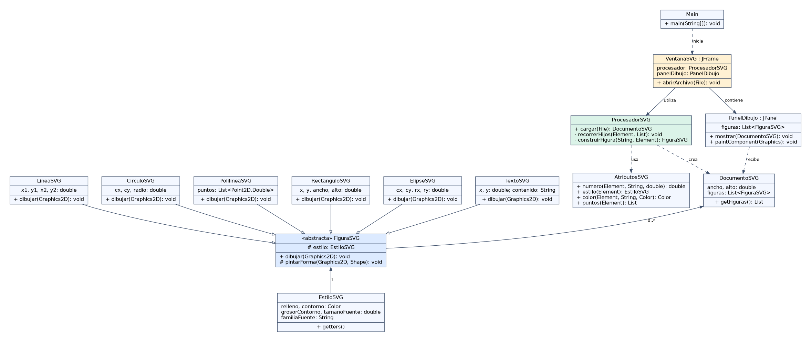
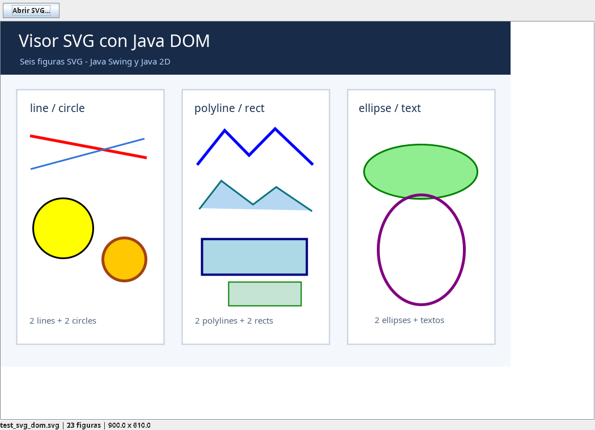
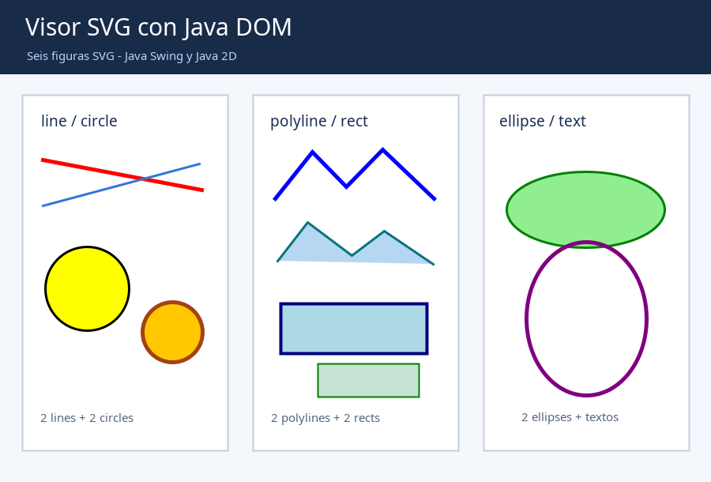

# Visualizador SVG con Java DOM y Java 2D

**Práctica de laboratorio:** Interpretación y representación de gráficos SVG utilizando Java DOM y Java 2D.

## 1. Propósito

La aplicación permite seleccionar archivos SVG, analizarlos como documentos XML con **DOM** y dibujar las figuras **`line`**, **`circle`**, **`polyline`**, **`rect`**, **`ellipse`** y **`text`** en una ventana **Java Swing** usando **`Graphics2D`**. No se emplean bibliotecas externas de procesamiento ni de renderizado SVG.

## 2. Requisitos y ejecución

- **Java JDK 11 o superior** (verificado al compilar con OpenJDK 21).
- IntelliJ IDEA es opcional. No se requieren Maven, Gradle ni dependencias externas.

### Opción A: IntelliJ IDEA

1. Descomprime el ZIP en tu equipo.
2. En IntelliJ IDEA, selecciona **File > Open**, elige la carpeta `visor-svg-dom` y ábrela como proyecto.
3. Comprueba que tienes configurado un **JDK** en **File > Project Structure > Project SDK**.
4. Si IntelliJ no reconoce el código fuente, haz clic derecho en `src` > **Mark Directory as > Sources Root**.
5. Abre `src/visor/Main.java`, selecciona **Run 'Main.main()'**.
6. En la ventana, pulsa **Abrir SVG...** y selecciona el archivo `test_svg_dom.svg` que se encuentra en la raíz del proyecto. También puedes ejecutar la clase `Main` con ese archivo como argumento de programa.
7. Para verificar la recarga, abre después `test_svg_alternativo.svg` sin cerrar el programa.

### Opción B: Windows con el JDK instalado

En el Explorador de archivos, entra en la carpeta del proyecto y ejecuta **`compilar_windows.bat`**. El script compila los `.java` y abre automáticamente el documento de ejemplo. También puedes usar PowerShell:

```powershell
cd "RUTA\A\visor-svg-dom"
.\compilar_windows.ps1
```

### Opción C: Linux/macOS desde terminal

Desde la carpeta raíz del proyecto:

```bash
mkdir -p out
javac -encoding UTF-8 -d out $(find src -name '*.java')
java -cp out visor.Main test_svg_dom.svg
```

Para ejecutar las pruebas automatizadas:

```bash
java -Djava.awt.headless=true -cp out visor.pruebas.PruebasSVG
```

La clase de pruebas escribe la imagen `evidencias/resultado_java2d.png` sin necesidad de abrir una ventana.

## 3. Estructura del proyecto

```text
visor-svg-dom/
├── src/visor/
│   ├── Main.java
│   ├── modelo/
│   │   ├── FiguraSVG.java
│   │   ├── EstiloSVG.java
│   │   ├── LineaSVG.java
│   │   ├── CirculoSVG.java
│   │   ├── PolilineaSVG.java
│   │   ├── RectanguloSVG.java
│   │   ├── ElipseSVG.java
│   │   └── TextoSVG.java
│   ├── parser/
│   │   ├── AtributosSVG.java
│   │   ├── DocumentoSVG.java
│   │   └── ProcesadorSVG.java
│   ├── ui/
│   │   ├── PanelDibujo.java
│   │   └── VentanaSVG.java
│   └── pruebas/
│       ├── PruebasSVG.java
│       └── CapturaVentana.java
├── test_svg_dom.svg
├── test_svg_alternativo.svg
├── test_atributo_invalido.svg
├── test_xml_malformado.svg
├── test_entidad_externa.svg
├── UML_diagrama_clases.png
├── uml_clases.dot
├── evidencias/
│   ├── captura_ventana_swing.png
│   └── resultado_java2d.png
├── compilar_windows.bat
├── compilar_windows.ps1
└── README.md
```

## 4. Actividad 1: estructura SVG y árbol DOM

Considérese el documento SVG del enunciado:

```xml
<svg xmlns="http://www.w3.org/2000/svg" width="500" height="350">
    <line x1="20" y1="20" x2="180" y2="100"
          stroke="blue" stroke-width="3"/>
    <circle cx="250" cy="100" r="50"
            fill="yellow" stroke="black"/>
</svg>
```

El nodo **`Document`** contiene como elemento raíz **`svg`**, y este tiene dos nodos `Element` hijos: **`line`** y **`circle`**. Sus atributos XML pertenecen a los propios elementos; pueden recuperarse con `getAttribute()` después de recorrer `NodeList` y comprobar que cada nodo sea `ELEMENT_NODE`.

- `line`: `x1`, `y1`, `x2`, `y2` indican los dos extremos del segmento; `stroke` y `stroke-width` controlan color y grosor.
- `circle`: `cx`, `cy`, `r` definen el centro y el radio. Para Java 2D, el rectángulo contenedor del círculo es `(cx-r, cy-r, 2*r, 2*r)`; `fill` y `stroke` indican relleno y contorno.
- El orden de los hijos dentro de `svg` determina el orden de dibujo: si dos figuras se superponen, la posterior se pinta encima de la anterior.

## 5. Arquitectura y principales decisiones

El diseño separa tres responsabilidades:

**Procesamiento XML (`parser`).** `ProcesadorSVG` valida el archivo, lo analiza con `DocumentBuilderFactory` y `DocumentBuilder`, identifica la raíz `svg` y recorre recursivamente los elementos con `Node` y `NodeList`, incluso dentro de los grupos `g`. Cada etiqueta soportada se convierte en un objeto Java. `AtributosSVG` centraliza la validación de números, coordenadas, colores y estilos. `DocumentoSVG` almacena dimensiones y lista de figuras en orden.

**Modelo de objetos (`modelo`).** `FiguraSVG` es una clase abstracta con el método polimórfico `dibujar(Graphics2D)`. Cada subclase almacena coordenadas propias y dibuja la figura correspondiente. `EstiloSVG` guarda relleno, contorno, grosor y parámetros de fuente. Los colores y estilos se interpretan al cargar el archivo, no al pintar.

**Presentación (`ui`).** `VentanaSVG` contiene un selector de archivos, una etiqueta de estado y un `JScrollPane`. `PanelDibujo` hereda de `JPanel`: su `paintComponent` se limita a invocar el dibujo de las figuras ya procesadas y a configurar el antialiasing. Al abrir otro archivo, reemplaza la lista de figuras y llama a `revalidate()` y `repaint()`.

El parser configura soporte de espacios de nombres y procesamiento seguro; **rechaza declaraciones `DOCTYPE` y bloquea acceso a entidades externas**, mitigando ataques XXE.

### Diagrama de clases UML



Archivo fuente editable: `uml_clases.dot` (Graphviz). La herencia permite agregar otra figura implementando `dibujar` sin modificar `PanelDibujo`.

## 6. Representación gráfica implementada

| SVG | Clase Java | Objeto gráfico de Java 2D |
|---|---|---|
| `line` | `LineaSVG` | `Line2D.Double` |
| `circle` | `CirculoSVG` | `Ellipse2D.Double` con radios iguales |
| `polyline` | `PolilineaSVG` | `Path2D.Double` |
| `rect` | `RectanguloSVG` | `Rectangle2D.Double` |
| `ellipse` | `ElipseSVG` | `Ellipse2D.Double` con radios distintos |
| `text` | `TextoSVG` | `Graphics2D.drawString` / contorno de glifos |

Una polilínea se mantiene **abierta al trazar el contorno**. Al rellenarla, Java 2D realiza el cierre implícito del camino. Las coordenadas del texto indican la **línea base**, no la esquina superior. Se usa `double` para las propiedades geométricas.

Por defecto, el relleno es negro, el contorno es `none`, su grosor es 1 y el tamaño de fuente es 16. Para los colores, se aceptan `none`, colores básicos nominales del subconjunto implementado y hexadecimales `#RGB` y `#RRGGBB`. Solo se interpretan los atributos escritos directamente en cada elemento, de acuerdo con el alcance indicado.

## 7. Pruebas realizadas y resultados

Se compiló el proyecto con OpenJDK 21 y se ejecutó `visor.pruebas.PruebasSVG`. Resultados:

| Prueba | Resultado |
|---|---|
| Abrir `test_svg_dom.svg` con DOM | **Correcto** |
| Identificar al menos dos elementos de cada uno de los seis tipos | **Correcto** (23 figuras en total) |
| Interpretar elementos anidados en `<g>` | **Correcto** |
| Mantener el orden de superposición y las coordenadas durante el render | **Representación Java 2D generada y revisada** |
| Dibujar colores de relleno, contorno y grosores variados | **Representación Java 2D generada y revisada** |
| Cargar `test_svg_alternativo.svg` mediante el parser | **Correcto** |
| Detectar un radio no numérico (`r="abc"`) | **Error detectado correctamente** |
| Detectar un documento XML mal formado | **Error detectado correctamente** |
| Rechazar `DOCTYPE` con entidad externa | **Correcto** |
| Mostrar la ventana Swing y cargar el archivo principal | **Ventana ejecutada y capturada en un escritorio virtual** |
| Comparar directamente el resultado con un navegador | **Pendiente de captura manual en el equipo del estudiante** |

### Evidencias

**Captura real de la aplicación Swing:** `evidencias/captura_ventana_swing.png`. Se generó ejecutando la ventana con el SVG principal en un escritorio gráfico virtual.



**Resultado del renderizado con Java 2D:** `evidencias/resultado_java2d.png`.



**Comparación con navegador (actividad manual restante):** abre `test_svg_dom.svg` en Chrome, Edge o Firefox; toma una captura del dibujo y colócala al lado de la captura Swing. Comprueba las posiciones, superposición, rellenos, contornos, grosor, texto y la polilínea con relleno. Es normal encontrar pequeñas diferencias en fuentes o antialiasing. La captura de navegador no se incluye en el proyecto porque no se logró generar en el entorno automatizado.

**Prueba de recarga en la interfaz:** ejecuta `Main`, usa **Abrir SVG...**, elige `test_svg_dom.svg` y después `test_svg_alternativo.svg`, sin cerrar la ventana. Se ha probado la carga por el parser, pero esta interacción específica del botón se debe verificar manualmente.

## 8. Problemas y limitaciones

1. En XML, todos los atributos se leen como cadenas: se valida su conversión a `double` y se rechazan `NaN`, valores infinitos o atributos inválidos para evitar errores de representación.
2. Se implementó un analizador de puntos `x,y` separado por comas o espacios para `polyline`; no cubre toda la gramática SVG avanzada.
3. Java 2D requiere convertir centros y radios de círculos y elipses a rectángulos contenedores.
4. Los estilos **no se heredan desde `g`**. No se admiten estilos CSS (`style`, clases), gradientes, rutas `path`, transformaciones, máscaras, recortes, animaciones, ni `viewBox`/escalamiento automático.
5. Los valores geométricos deben ser **números simples sin unidades**; no se implementan `%`, `cm`, `em`, etc. La familia tipográfica puede variar según las fuentes instaladas y no se soportan opciones avanzadas de texto.
6. No se garantiza un render idéntico al de todos los navegadores, sino una representación equivalente para los seis elementos y atributos del alcance.
7. El proyecto usa un analizador síncrono al abrir archivos, apropiado para este ejercicio; para archivos enormes convendría mover la lectura a un `SwingWorker`.

## 9. Preguntas de reflexión

**1. ¿Qué ventajas y desventajas presenta DOM frente a SAX para procesar documentos SVG?**  
DOM crea en memoria un árbol completo, lo cual facilita navegar, consultar atributos y recorrer grupos anidados. Su desventaja es el mayor consumo de memoria y tiempo de carga en archivos grandes. SAX analiza eventos mientras lee, lo que puede ahorrar memoria, pero obliga a mantener manualmente el estado y la jerarquía, dificultando el procesamiento de estructuras complejas.

**2. ¿Cómo se relaciona la estructura jerárquica XML con su representación mediante objetos Java?**  
El árbol DOM conserva la relación padre-hijo de `svg`, `g` y las figuras. El procesador recorre esa jerarquía y convierte los nodos gráficos en objetos como `CirculoSVG` o `RectanguloSVG`, que almacenan atributos convertidos a tipos Java. La lista de objetos respeta el orden de aparición en el árbol, aunque no reproduce todos los nodos XML originales.

**3. ¿Qué ventajas ofrece utilizar polimorfismo para implementar el renderizado?**  
Todas las figuras comparten el contrato `dibujar(Graphics2D)`. El panel no necesita condicionales para saber si una figura es círculo, línea o texto: invoca el mismo método y la implementación concreta decide cómo dibujarse. Esto reduce el acoplamiento y permite ampliar el sistema.

**4. ¿Por qué es conveniente separar el procesamiento XML de la representación gráfica?**  
Porque la lectura del archivo y la pintura de pantalla tienen responsabilidades diferentes. El parser se prueba sin interfaz y se ejecuta una sola vez al cargar; `paintComponent` puede invocarse repetidamente sin volver a analizar XML. Esta separación mejora el rendimiento, las pruebas y el mantenimiento.

**5. ¿Qué dificultades aparecen al interpretar atributos geométricos expresados como cadenas de texto?**  
Hay que validar que los valores existan cuando son necesarios, que sean numéricos y finitos, que los radios o dimensiones no sean negativos, y que las coordenadas de `points` formen pares. También deben considerarse los valores predeterminados, las unidades no soportadas y los mensajes de error.

**6. ¿Cómo podría ampliarse la arquitectura para incorporar nuevos elementos SVG?**  
Se crearía una nueva subclase de `FiguraSVG`, por ejemplo `PoligonoSVG`, con sus datos geométricos y una implementación de `dibujar`. Se añadiría la conversión de la nueva etiqueta en `ProcesadorSVG`, sin modificar `PanelDibujo` ni las figuras existentes.

**7. ¿Qué modificaciones serían necesarias para implementar transformaciones geométricas como traslación, rotación y escalamiento?**  
Sería necesario interpretar el atributo `transform`, almacenar las transformaciones en cada figura o grupo y aplicar un `AffineTransform` sobre una copia de `Graphics2D` antes de dibujar. Habría que combinar las transformaciones de los grupos anidados respetando su orden y restaurar el contexto gráfico después de cada figura.

## 10. Conclusión

El ejercicio muestra cómo un documento SVG basado en XML puede convertirse mediante DOM en objetos Java independientes de la interfaz, y cómo esos objetos se dibujan polimórficamente mediante Swing y Java 2D. La solución cubre los seis elementos del enunciado dentro de un subconjunto deliberadamente limitado de SVG.
